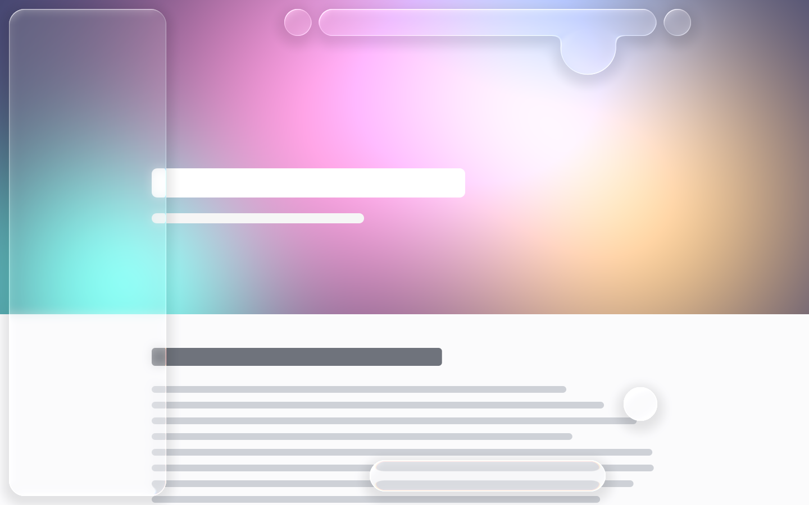

# Axion

A fast, privacy-first web browser for Linux with an iPadOS-Safari-inspired interface
and real **Liquid Glass** — written in Rust.

> **Status:** early development — the browser runs (tabs, address bar, sidebar, Liquid Glass
> chrome), most features are still to come. See [plan.md](plan.md).



## Highlights (planned)

- **iPad Safari layout** — floating compact tab bar, sidebar, tab overview grid, responsive.
- **Liquid Glass** — translucent, refractive UI that bends the page behind it, merges like
  liquid and responds to drags with real physics.
- **Shields** — built-in ad, tracker, popup and redirect blocking (powered by `adblock-rust`).
- **Native media player** — own glass video controls, fullscreen and Picture-in-Picture; playback always gets priority.
- **Memory control** — tabs freeze and discard automatically; set your own memory budget.
- **Customizable** — glass look, keybinds, tab policies, everything in a settings UI or `config.toml`.

## Tech

Rust · Chromium (CEF, off-screen rendering) · wgpu · winit

## Building

Requirements: Rust stable, cmake, ninja, a C++ compiler, a Vulkan-capable GPU, Wayland or X11.
The first build downloads Chromium Embedded Framework (~1 GB) into `third_party/cef`.

```bash
cargo run -p axion-app --release -- https://example.com
```

Try the glass on its own (no Chromium needed):

```bash
cargo run -p axion-glass --example playground --release
```

Settings live in `~/.config/axion/config.toml`, shortcuts in `~/.config/axion/keymap.toml`
(both optional, reloaded live).

## License

TBD.
