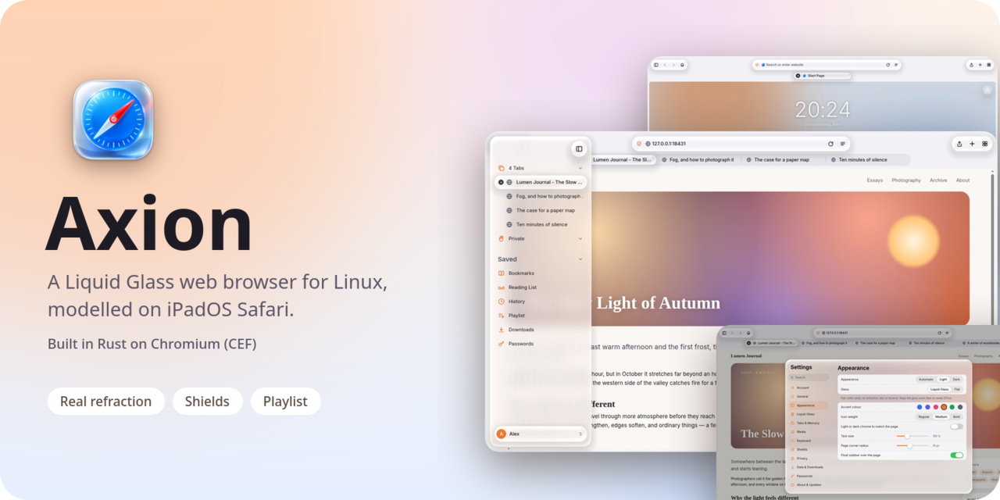
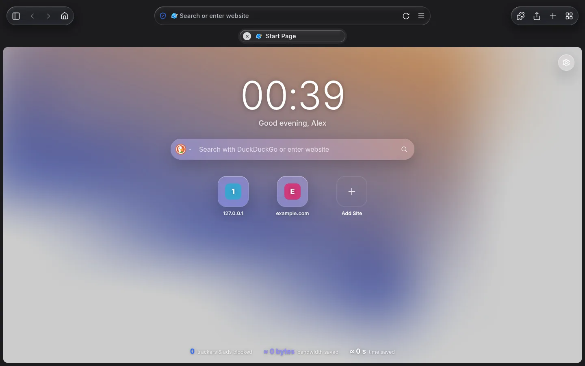
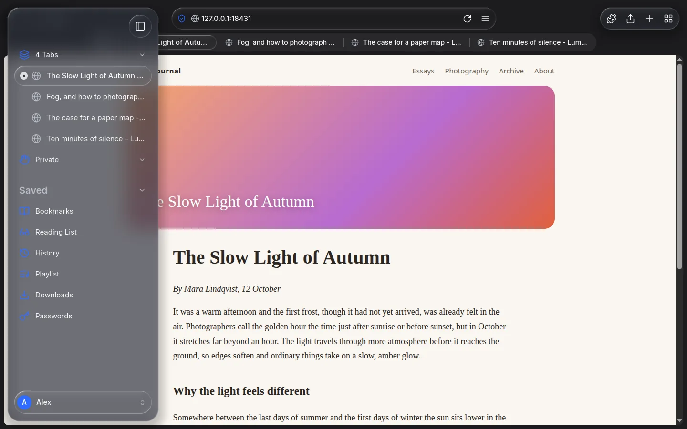
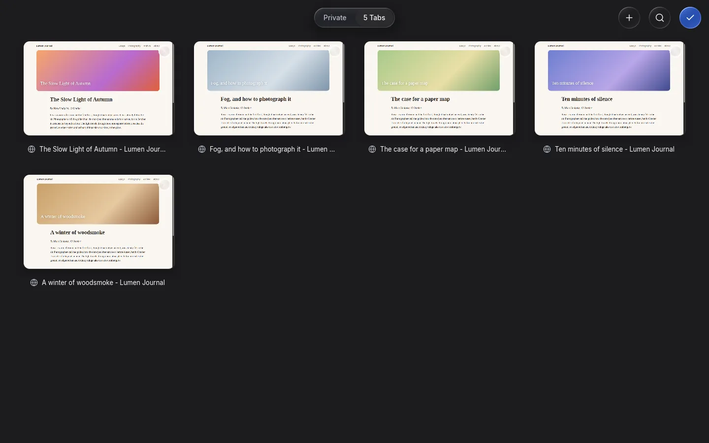
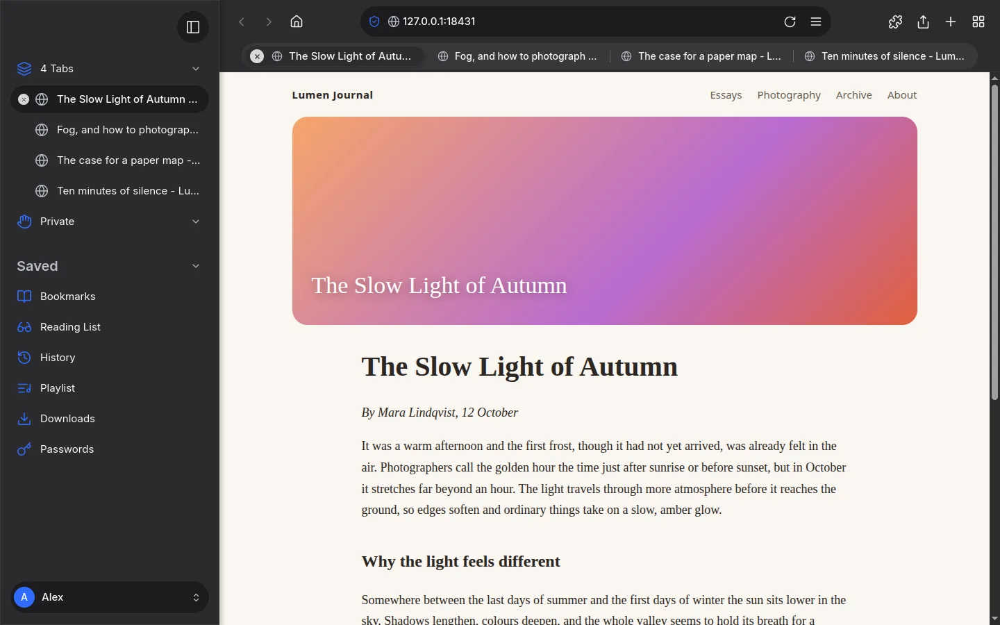
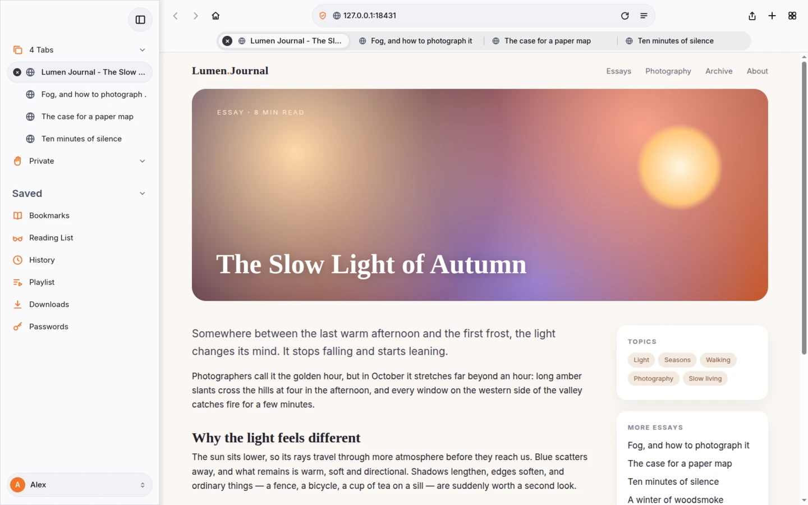

<div align="center">

<picture>
  <source media="(prefers-color-scheme: dark)" srcset="assets/hero-dark.png">
  
</picture>

# Axion

**A Liquid Glass web browser for Linux, modelled on iPadOS Safari - built in Rust on Chromium (CEF).**

[](LICENSE)
[](https://www.rust-lang.org/)
[](#requirements)
[](#status-and-roadmap)

[Features](#features) ·
[Screenshots](#screenshots) ·
[Build and run](#build-and-run) ·
[Configuration](#configuration) ·
[Shortcuts](#keyboard-shortcuts) ·
[Architecture](#architecture) ·
[Contributing](#contributing)

</div>

---

Axion is a desktop browser that takes the calm, touch-friendly layout of Safari on iPadOS 26 - a
sidebar, a compact tab bar, a tab overview grid - and renders it with **real Liquid Glass**:
translucent, refractive, physically animated material that bends and tints the web page behind it.
It runs the Chromium engine (through the Chromium Embedded Framework) and ships with built-in
content blocking on par with the best privacy browsers, memory controls for people with many tabs,
and its own media player.

Everything is drawn by Axion itself on the GPU with [wgpu](https://wgpu.rs/): web pages arrive as
textures, and the interface, the glass and the page are composited in a single frame, so glass
genuinely refracts whatever is underneath it.

> [!NOTE]
> Axion is in **early development** (version 0.0.x). It is usable day to day on the author's machine,
> but expect rough edges, missing features and breaking changes. See [Status and roadmap](#status-and-roadmap).

## Features

### Interface

- **Liquid Glass** - the toolbar, tab bar, sidebar, menus, popovers and sheets are glass. Shapes are
  signed distance fields, so neighbouring shapes merge like drops and split again, stretch and squash
  while you drag, and spring back with real physics. The material refracts and disperses the content
  beneath it, blurs it, adds a specular rim and adapts its tint for legibility on any backdrop.
- **Flat mode** - one switch turns glass into solid cards with a border and a soft shadow, skipping
  the glass passes entirely. Same layout, much lighter on weak GPUs. "Reduce Transparency" and
  "Reduce Motion" settings degrade the effects gracefully.
- **Safari-style layout** - choose a *separate* tab row below the address bar or a *compact* single
  row where the current tab holds the address. The sidebar can dock next to the page or float over it
  (and then refracts it). The page is a rounded card; the chrome flips between light and dark to
  match the page's top edge.
- **Tab overview** - a grid of live tab thumbnails with a Private / tabs switch and search.
- **Sidebar** - tab groups, a locked *Private* section, Bookmarks, Reading List, History, Playlist,
  Downloads and Passwords, plus the account switcher at the bottom.
- **Start page** - clock and greeting, search field, your top sites, Shields statistics (trackers
  blocked, bandwidth and time saved) and your own backgrounds, including animated and **video live
  wallpapers**.
- **Context menus**, address-bar suggestions, find on page, zoom, share, downloads popover and a
  glass toast/alert system - all native Axion UI, not web content.
- **Light, dark or automatic** theme, accent colours, text scale, icon weight and corner radius.
- **English and German** interface.
- **First-run tour** - a five-step introduction that lets you pick language, theme, accent, tab bar
  style, sidebar mode and glass level with a live preview (replayable from Settings).

### Privacy and security

- **Shields** - network and cosmetic filtering with Brave's
  [`adblock-rust`](https://github.com/brave/adblock-rust) (EasyList, EasyPrivacy, uBlock lists,
  auto-updating, user-addable lists), plus Axion's own popup blocking, redirect and tab-under
  protection, and tracking-parameter stripping. Per-site levels (Off / Standard / Aggressive) from a
  popover on the shield in the address bar; per-site exceptions instead of weakening defaults.
- **Private browsing** - private tabs live in a separate in-memory profile and can be **locked
  behind your account password**.
- **Password manager** - logins, cards, addresses and secure notes in an encrypted vault
  (XChaCha20-Poly1305 per item). The vault key needs two factors: your master password (Argon2id)
  *and* a device secret, which is sealed in the **TPM** when one is available (otherwise a key file
  outside the profile). Copying the profile to another machine does not expose the vault.
- **Local accounts** - every account is a fully separate profile (tabs, history, bookmarks,
  downloads, passwords, website data, settings, keymap) with an avatar and its own password.
  Switching accounts relaunches Axion into the other profile.

### Performance and memory

- **Tab lifecycle** - background tabs are *frozen* after a configurable idle time and *discarded*
  after a longer one or when you exceed your **memory budget**. Pinned tabs, tabs playing audio,
  tabs with active downloads and exempt sites are never touched. All thresholds are settings.
- **Playback comes first** - media tabs are never frozen and video frames are never dropped for UI
  effects. The compositor targets 120 fps on an integrated GPU.
- **GPU frame sharing** (dma-buf) with an automatic CPU fallback; the Chromium GPU process is pinned
  to the same GPU as the compositor.

### Media

- **Own media player** - when a video goes fullscreen, Axion's glass controls take over: play/pause,
  seek, volume, speed, captions, Picture-in-Picture, and keyboard control (`Space`, `J`/`K`/`L`,
  `M`, `F`, `C`, `<`/`>`...).
- **Picture-in-Picture** window and **MPRIS** integration (media keys, desktop media widgets).
- **Playlist** - save videos for later (`Ctrl+Shift+D`) and optionally download them for offline
  viewing. A dedicated page with a thumbnail list, search, sorting, shuffle/repeat, speed, sleep
  timer, remembered positions and "continue watching". Playback shows only the video, never the
  surrounding site.

### Productivity and developer tools

- **Bookmarks and history** in SQLite, with session restore.
- **Downloads** list with progress and a popover.
- **DevTools** - Chromium's own developer tools (`F12`, console on `Ctrl+Shift+J`, view source on
  `Ctrl+U`).
- **Fully remappable shortcuts** (`keymap.toml`) and a settings UI for everything, including memory
  budgets and the tab-freezing policy.
- **Updater** - checks the project's GitHub releases and can update an AppImage in place or a source
  checkout via `git pull --ff-only` and a rebuild. Nothing else is ever sent (no telemetry).

## Screenshots

<table>
  <tr>
    <td width="50%"><br><sub><b>Start page</b> - wallpaper, search, top sites and Shields statistics.</sub></td>
    <td width="50%"><br><sub><b>Liquid Glass sidebar</b> floating over a page and refracting it.</sub></td>
  </tr>
  <tr>
    <td width="50%"><br><sub><b>Tab overview</b> - a grid of live tabs.</sub></td>
    <td width="50%"><br><sub><b>Playlist</b> - videos for later, optionally offline.</sub></td>
  </tr>
  <tr>
    <td width="50%"><br><sub><b>Settings</b> - Appearance (dark).</sub></td>
    <td width="50%"><br><sub><b>Settings</b> - Appearance (light).</sub></td>
  </tr>
  <tr>
    <td width="50%"><br><sub><b>Light mode</b> start page.</sub></td>
    <td width="50%"><br><sub><b>Light mode</b> with the floating sidebar.</sub></td>
  </tr>
  <tr>
    <td width="50%"><br><sub><b>Flat mode</b> (dark) - solid cards for weak GPUs.</sub></td>
    <td width="50%"><br><sub><b>Flat mode</b> (light).</sub></td>
  </tr>
  <tr>
    <td width="50%"><br><sub><b>Tab overview</b> (light).</sub></td>
    <td width="50%"><br><sub><b>First-run tour</b> - choose your look.</sub></td>
  </tr>
</table>

<sub>The screenshots show a local demo page and generated wallpapers.</sub>

## Requirements

- **Linux** with **Wayland** (primary) or **X11**. Windows and macOS are not supported.
- A **Vulkan-capable GPU** (NVIDIA, AMD or Intel; integrated GPUs are a design target).
- **Rust** stable, 1.90 or newer (2024 edition), plus `cmake`, `ninja` and a C++ compiler.
- Roughly **1 GB of disk space** for the Chromium Embedded Framework download (fetched automatically
  on the first build into `third_party/cef`, which is git-ignored).
- Common desktop fonts; the interface uses Inter when installed and falls back to system fonts.
- Optional: `libtss2` and access to `/dev/tpmrm0` (group `tss`) to seal the password vault's device
  key in the TPM. Without it Axion uses a key file under `~/.local/share/axion`.

## Build and run

```bash
git clone https://github.com/xyzhenrik/Axion.git
cd Axion
cargo run -p axion-app --release -- [url]
```

The first build downloads CEF (~1 GB) and compiles a large dependency tree, so be patient. Run
`cargo test --workspace` to execute the tests.

Building without the TPM backend (no `libtss2` installed):

```bash
cargo run -p axion-app --release --no-default-features -- [url]
```

To try the glass on its own, without Chromium:

```bash
cargo run -p axion-glass --example playground --release            # interactive
cargo run -p axion-glass --example playground --release -- --demo  # scripted drag (merge / stretch)
cargo run -p axion-glass --example playground --release -- --bench # GPU time per 1440p frame
```

### Desktop entry and icon

On Wayland, compositors take the window icon from a desktop entry, not from the window. To install
one for your user (idempotent; add `--uninstall` to remove it again):

```bash
tools/install-desktop.sh [--bin PATH]
```

### H.264 / AAC codecs (optional)

The prebuilt CEF has no proprietary codecs, so H.264/AAC video will not play. `tools/build-cef.sh`
builds a matching CEF with `proprietary_codecs=true`. **This takes hours and about 100 GB of disk
space**, so run it in the background (`CEF_BUILD_DIR` selects the work directory, default
`~/cef-build`). VP8/VP9/AV1 and Opus/Vorbis work out of the box.

### Command line

```text
axion [url...] [--account=ID] [--size=1440x900] [--position=X,Y] [--maximized]
      [--overview] [--onboarding] [--capture=out.png] [--after=SECONDS]
axion --check-update      # ask the update source once, print the answer and exit
```

`--capture=out.png` renders the window to a PNG after a few seconds (`--after=` changes the delay)
and quits - handy for screenshots and visual regression checks without touching your desktop.

### Environment variables

| Variable | Effect |
|---|---|
| `AXION_GPU=low` | Use the integrated GPU (the performance budget case). |
| `AXION_OSR=software\|gpu` | Force page frame sharing off or on. Default: GPU (dma-buf) import on NVIDIA only; the AMD path is still being investigated, so do not force `gpu` there. |
| `AXION_CONFIG_DIR` | Base directory for settings (default `~/.config/axion`). |
| `AXION_PROFILE_DIR` | Base directory for browsing data (history, cookies, ...). |
| `AXION_DEVICE_KEY_DIR` | Where the password vault's device key lives (default `~/.local/share/axion`). |
| `AXION_MONITOR=HDMI-A-1` | Open the window on that monitor (X11/XWayland only: run with `env -u WAYLAND_DISPLAY`). |
| `AXION_CHROMIUM_SWITCHES=a=b,c` | Extra Chromium command-line switches, comma-separated. |
| `AXION_NO_SANDBOX=1` | Disable Chromium's sandbox (for containers and test runs). |

For throwaway test runs, point `AXION_CONFIG_DIR`, `AXION_PROFILE_DIR` and `AXION_DEVICE_KEY_DIR` at
temporary directories so your real profile and vault key are never touched.

## Configuration

Settings are edited in the app (**Settings**, `Ctrl+,`) and live in TOML files, reloaded live:

```text
~/.config/axion/
  accounts.toml                # the list of local accounts
  accounts/<id>/config.toml    # settings of that account (partial files are fine)
  accounts/<id>/keymap.toml    # shortcuts of that account
```

Browsing data lives per account under `~/.local/share/axion/` (or `AXION_PROFILE_DIR`). Every
user-facing behaviour has a key with a sensible default; anything missing from a file falls back to
it. A few examples:

```toml
# ~/.config/axion/accounts/<id>/config.toml
[general]
language = "en"              # "system" | "en" | "de"
search_url = "https://duckduckgo.com/?q={}"

[appearance]
theme = "dark"               # "light" | "dark" | "auto"
accent = "#F2742B"

[glass]
style = "liquid"             # "liquid" | "flat"

[layout]
tab_bar = "separate"         # "separate" | "compact"
float_sidebar = true
bookmarks_bar = "never"

[tabs]
freeze_after_minutes = 5
discard_after_minutes = 30
limit_memory = true
memory_budget_mb = 3072

[home]
show_clock = true
background = "my-wallpaper.jpg"
```

```toml
# keymap.toml - an entry replaces that action's default chords
focus_address_bar = ["Alt+D", "Ctrl+K"]
toggle_sidebar = ["Ctrl+Shift+L"]
tab_overview = []            # unbind
```

## Keyboard shortcuts

Everything about tabs is `Alt`+key (or an F-key); browser and system actions are `Ctrl`+key.
Pages keep `Ctrl+W` and `Ctrl+T`. All of these can be remapped in Settings or `keymap.toml`.

| Action | Default |
|---|---|
| New tab / close tab / reopen closed tab | `Alt+T` / `Alt+Q` / `Alt+Shift+T` |
| Next / previous tab | `Alt+Down`, `Alt+PageDown`, `Ctrl+Tab` / `Alt+Up`, `Alt+PageUp`, `Ctrl+Shift+Tab` |
| Select tab 1-8 / last tab | `Alt+1`...`Alt+8` / `Alt+9` |
| Pin or unpin tab | `Alt+P` |
| Tab overview | `Alt+O`, `F9` |
| Address bar | `Alt+D`, `F6`, `Ctrl+K` |
| Back / forward | `Alt+Left`, `Ctrl+[` / `Alt+Right`, `Ctrl+]` |
| Reload / hard reload | `Ctrl+R`, `F5` / `Ctrl+Shift+R`, `Ctrl+F5` |
| Toggle sidebar | `Ctrl+Shift+L` |
| Bookmark page / bookmarks / history | `Ctrl+D` / `Ctrl+B` / `Ctrl+H` |
| Playlist: open / add video | `Ctrl+Shift+P` / `Ctrl+Shift+D` |
| Passwords | `Ctrl+P` |
| Lock private tabs and password filling | `Ctrl+L` |
| Find / next / previous | `Ctrl+F` / `Ctrl+G`, `F3` / `Ctrl+Shift+G`, `Shift+F3` |
| Zoom in / out / reset | `Ctrl++` / `Ctrl+-` / `Ctrl+0` |
| Paste / paste as plain text | `Ctrl+V` / `Ctrl+Shift+V` |
| Settings | `Ctrl+,`, `Ctrl+S` |
| Fullscreen | `F11` |
| DevTools / console / view source | `F12`, `Ctrl+Shift+I` / `Ctrl+Shift+J` / `Ctrl+U` |
| Quit | `Ctrl+Q` |

While a video plays fullscreen with Axion's controls: `Space`/`K` play/pause, `Left`/`J` and
`Right`/`L` seek, `Up`/`Down` volume, `M` mute, `F` or `Esc` leave fullscreen, `C` captions,
`Shift+,` / `Shift+.` slower / faster. On a touchpad, two-finger swipes go back and forward and
pinching opens the tab overview.

## Architecture

Axion is a Cargo workspace. Dependencies point downwards: `axion-app` depends on everything; the
non-rendering crates (`engine`, `shields`, `tabs`, `store`, `config`, `accounts`, `vault`, `update`,
`media`) never depend on the UI or rendering crates.

| Crate | Purpose |
|---|---|
| `axion-app` | The `axion` binary: window, input routing, tabs, chrome (bar and sidebar), settings, player, playlist, wiring. |
| `axion-engine` | `Engine` trait and the Chromium (CEF) backend: off-screen rendering, dma-buf frames, input, popups, downloads, DevTools. |
| `axion-compositor` | Builds a frame from layers (page textures, glass, quads, text, icons) and the luminance probe. |
| `axion-glass` | Liquid Glass: SDF shapes and merging, refraction, blur, specular, WGSL shaders. |
| `axion-physics` | Springs, drag and fling, rubber-banding, gesture-to-motion mapping. |
| `axion-ui` | Retained widget tree, `taffy` layout, `glyphon` text, hit-testing, focus and editing. |
| `axion-config` | Settings schema with design-token defaults, TOML load/save, live reload, keymap. |
| `axion-shields` | `adblock-rust` engine, filter-list cache, popup/redirect/cookie policy, tracking parameters. |
| `axion-store` | SQLite storage: history, bookmarks, session, downloads, top sites, playlist, per-site settings. |
| `axion-accounts` | Local accounts, per-account directories and migration. |
| `axion-vault` | The password manager's encrypted, device-bound vault (Argon2id, XChaCha20-Poly1305, TPM sealing). |
| `axion-tabs` | Tab lifecycle planner (freeze/discard by idle time and memory budget) and the memory monitor. |
| `axion-media` | The media bridge script and protocol; MPRIS lives in the app. |
| `axion-i18n` | Gettext-style translations (English source text is the key; German catalog included). |
| `axion-update` | Release checks (GitHub or a manifest), checksum verification, AppImage and Git updates. |

**Rendering model.** CEF renders each visible tab off-screen and hands frames over as dma-buf
textures (or CPU buffers as a fallback). The compositor draws an ordered list of layers; every glass
layer samples the *already-rendered layers beneath it*, which is why glass refracts both page
content and other UI. Glass shapes are signed distance fields merged with a smooth minimum; the
refraction offset comes from the field's gradient and a lens height profile, with chromatic
dispersion, a downsampled blur, rim light and a backdrop-adaptive tint.

## Status and roadmap

Axion is **early alpha**. What works today:

- The full browsing chrome (tabs, address bar, sidebar, tab overview, menus, find,
  zoom, downloads, settings) in Liquid Glass and flat modes, light and dark.
- Shields, per-site settings, private tabs, accounts, the password manager, bookmarks, history,
  session restore, the start page with backgrounds, DevTools.
- Tab freezing and discarding with a memory budget.
- The media player, fullscreen, Picture-in-Picture, MPRIS and the Playlist with offline downloads.
- The first-run tour, English and German UI, and the updater.

Known gaps and ideas:

- **H.264/AAC** requires a self-built CEF (see above); some streaming sites will not play without it.
- HLS/DASH streams cannot be downloaded for offline viewing (they can be watched online).
- Switching accounts relaunches Axion instead of switching in-process.
- Share sheet, reading-list entries beyond the basics, importing bookmarks and history from other
  browsers, a few page-menu items (translate, reader mode, request mobile site).
- Touch-screen polish; touchpad and mouse are the primary inputs.
- Packaging (AUR, Flatpak, AppImage) and crash handling.
- Later: a subset of Chrome extensions, encrypted sync, reader mode, an alternative engine behind
  the `Engine` trait (for example Servo), and other operating systems.

## Updating

**Settings > About & Updates** checks the releases of
[`xyzhenrik/Axion`](https://github.com/xyzhenrik/Axion) once a day (configurable) and tells you when
a newer version is available. Depending on how Axion was installed it can:

- replace an **AppImage** in place after verifying its SHA-256 checksum,
- update a **source checkout** (`git pull --ff-only`, then `cargo build -p axion-app --release`; only
  when the working tree is clean and the remote matches the configured repository), or
- open the release page for other installations (packages update through their package manager).

You can skip a version, be reminded later, switch to pre-releases or turn update checks off. Every
action that changes anything asks for confirmation first, and nothing but a plain HTTP request is
sent. `axion --check-update` does the same check from the command line.

## Contributing

Issues and pull requests are welcome. Before sending a change, please make sure that

```bash
cargo fmt --all --check
cargo clippy --workspace --all-targets -- -D warnings
cargo test --workspace
```

all pass, and keep to the project conventions:

- Code, comments, commit messages and UI strings are in **English** (user-visible strings go through
  `axion-i18n`).
- Errors: `thiserror` in library crates, `anyhow` only in `axion-app`. Logging with `tracing`, no
  `println!`.
- No `unwrap()`/`expect()` in non-test code unless the invariant is documented in a comment.
- `unsafe` only in `axion-engine` (CEF FFI) and GPU interop, each block with a `// SAFETY:` comment.
- Every user-facing behaviour gets a setting in `axion-config` with a sensible default - no magic
  numbers for timings, sizes or limits. Shortcuts go through the keymap, never matched in UI code.
- Visual changes are verified with `--capture`; performance changes with the glass playground's
  `--bench` on both a discrete and an integrated GPU (`AXION_GPU=low`).
- Never weaken a Shields default to make a site work; add a per-site exception instead.

## License

Licensed under the terms in the [LICENSE](LICENSE) file.

## Acknowledgements

Axion stands on the shoulders of many projects, among them
the [Chromium Embedded Framework](https://bitbucket.org/chromiumembedded/cef) and the
[Chromium](https://www.chromium.org/) project, [`cef-rs`](https://github.com/tauri-apps/cef-rs),
[wgpu](https://wgpu.rs/), [winit](https://github.com/rust-windowing/winit),
[taffy](https://github.com/DioxusLabs/taffy), [glyphon](https://github.com/grovesNL/glyphon),
Brave's [adblock-rust](https://github.com/brave/adblock-rust),
[rusqlite](https://github.com/rusqlite/rusqlite) and SQLite, [hls.js](https://github.com/video-dev/hls.js)
(Apache-2.0) and the wider Rust ecosystem.

Axion's design is inspired by Apple's Safari on iPadOS, but it contains **no Apple assets, code or
branding**. Safari is a trademark of Apple Inc. Axion is an independent project and is not
affiliated with, endorsed by or sponsored by Apple Inc., Google LLC or Brave Software, Inc.
