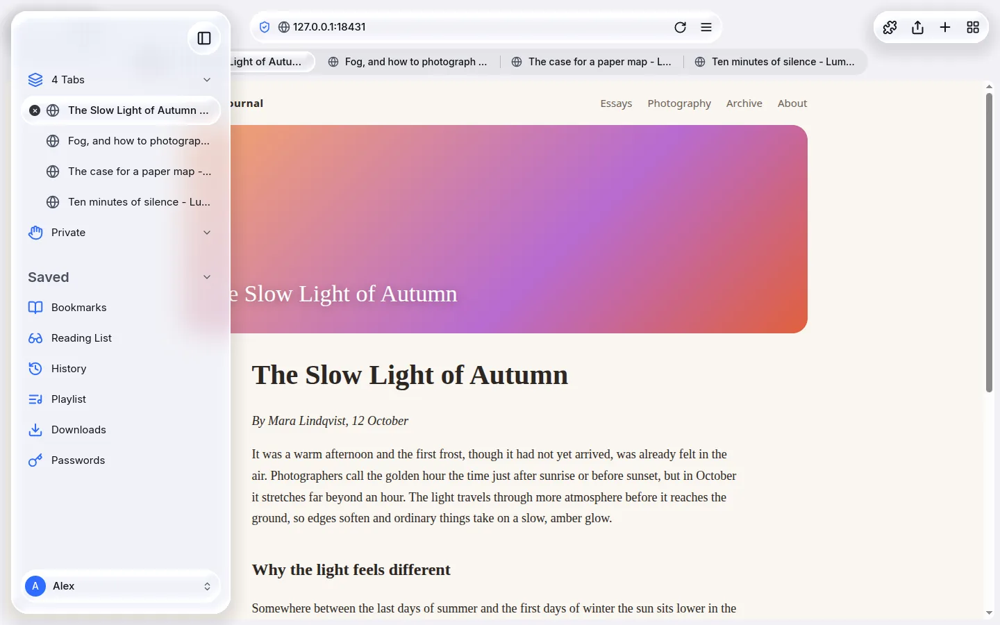

# Axion documentation

Axion is a web browser for Linux with a calm, Safari-style layout and a Liquid Glass look.
These pages explain what it can do and, above all, what each setting does.

## Start here

- [Install](install.md) - the AppImage and the tarball, what your system needs, the sandbox, uninstalling.
- [Getting started](getting-started.md) - get Axion, the first launch, and the basics.
- [Settings reference](settings.md) - every setting, page by page, with defaults.
- [Keyboard shortcuts](keyboard-shortcuts.md) - the default keys and how to change them.

## Features

| Page | What it covers |
|---|---|
| [Shields](features/shields.md) | Blocking ads, trackers, popups and redirects. |
| [Tabs and memory](features/tabs-and-memory.md) | Freezing and unloading background tabs, the memory budget. |
| [Accounts and privacy](features/accounts-and-privacy.md) | Local accounts, private tabs, locking, how your data is protected. |
| [Site permissions](features/site-permissions.md) | Microphone, camera, screen sharing (Discord, Meet), notifications, location; the recording indicator. |
| [Passwords](features/passwords.md) | Saving, filling, cards, addresses, notes, import and export. |
| [Media and Playlist](features/media-and-playlist.md) | The video player, Picture in Picture, media keys, the Playlist. |
| [Reading and translation](features/reading-and-translation.md) | Reader View, translating pages on this computer. |
| [Start page](features/start-page.md) | Clock, top sites, search, backgrounds and statistics. |
| [Appearance and Liquid Glass](features/appearance-and-glass.md) | Themes, accent colours, glass or flat, layout options. |
| [Chrome extensions](features/extensions.md) | Installing Manifest V3 extensions, permissions, limits. |
| [Developer tools](features/developer-tools.md) | F12, view source, Inspect. |
| [Hardware acceleration](features/hardware-acceleration.md) | Graphics card and video decoding options. |
| [Updates](features/updates.md) | How Axion finds and installs new versions. |

## Reference

- [Configuration files](configuration.md) - where Axion keeps things, `config.toml`, `keymap.toml`, environment variables, backups.
- [Troubleshooting](troubleshooting.md) - videos that do not play, microphone, camera and screen sharing, graphics problems, locked tabs, reporting a bug.

## Conventions in these pages

- Names of buttons and settings are written in **bold**, exactly as they appear in the English interface.
- "Settings" means the settings sheet. Open it with **Ctrl+,** or from the page menu.
- Paths starting with `~` are in your home folder.
