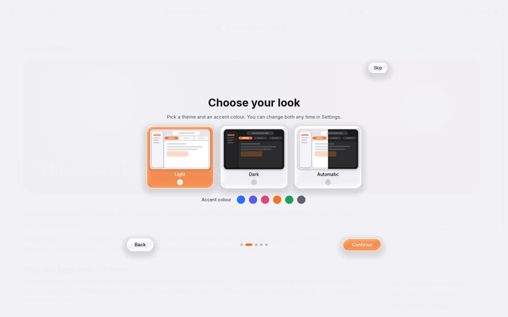
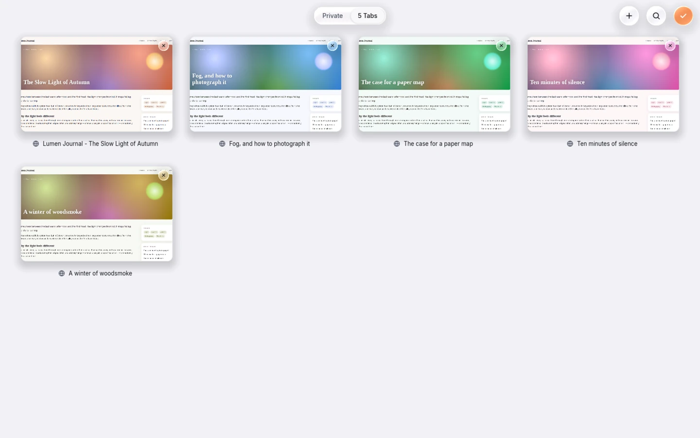

# Getting started

## Get Axion

Axion is early software. You can install a release or build it yourself. All the details for a
release (what your system needs, the sandbox, uninstalling) are on the [Install](install.md) page.

**From a release (AppImage or tarball).** Download the AppImage, make it executable and start it:

```bash
chmod +x Axion-*.AppImage
./Axion-*.AppImage
```

or unpack the tarball and run `./install.sh` for a menu entry and an `axion` command. Axion can
update an AppImage for you. See [Updates](features/updates.md).

**From source.** You need Rust (stable), `cmake`, `ninja`, a C++ compiler and a Vulkan-capable
graphics card. Wayland and X11 both work.

```bash
git clone https://github.com/xyzhenrik/Axion.git
cd Axion
cargo run -p axion-app --release -- https://example.com
```

The first build downloads the Chromium engine (about 1 GB) and compiles a lot of code, so it takes a
while. The full requirements and build options are in the [README](../README.md#build-and-run).

**Optional extras**

- A desktop icon on Wayland: Axion installs its own desktop entry at start (the first start may still show the generic icon; see [Troubleshooting](troubleshooting.md)).
- Video from sites that use H.264/AAC: needs a special engine build (see [Troubleshooting](troubleshooting.md)).

## The first launch

On a fresh install Axion shows a short introduction in five steps (six when other browsers are
installed). Your choices apply live, so you see the result right away.



1. **Welcome** - pick the interface **Language**.
2. **Choose your look** - theme (**Light**, **Dark** or **Automatic**) and accent colour.
3. **Tabs and sidebar** - tabs in their own row (**Separate**) or inside the address bar
   (**Compact**), and a **Docked** or **Floating** sidebar.
4. **Glass or flat** - **Liquid Glass**, or **Flat** for weaker graphics hardware. You can also turn
   on **Reduce transparency** and **Reduce motion** here.
5. **Bring your bookmarks** - only shown when Axion finds other browsers (Chrome, Firefox, Brave and
   so on) on this computer. Tick the ones to import bookmarks, history and site icons from; the most recently
   used one is ticked. Continue starts the import in the background. Nothing is changed in the other
   browsers.
6. **Your account** - name, picture and an optional password. (Step 5 without other browsers.)

You can skip the tour at any time. To see it again, open **Settings > General** and press
**Show Welcome Tour**. Everything the tour sets can be changed later in [Settings](settings.md).

## Accounts

Axion keeps your data in a local **account**. Each account has its own tabs, history, bookmarks,
passwords, website data and settings. The first account is created for you on the first start.

- The account button is at the bottom of the sidebar. Click it to switch accounts, add one, open
  the account settings or lock.
- Switching accounts restarts Axion into the other account.
- An optional password protects your saved passwords and your private tabs.

More in [Accounts and privacy](features/accounts-and-privacy.md).

## The basics

### The address field

Click the address field (or press **Alt+D** or **F6**) and type a web address or a
search. Suggestions from your bookmarks and history appear while you type. Anything that is not an
address is searched with your **Search engine** (DuckDuckGo unless you change it in
**Settings > General**).

Next to the address field you find the Shields button (blocking), the Playlist button on pages with
a video, the reload button and the page menu.

### Tabs

- **New tab:** **Alt+T**. **Close tab:** **Alt+Q**. **Reopen a closed tab:** **Alt+Shift+T**.
- **Switch:** **Alt+1** to **Alt+8**, **Alt+9** for the last tab, or **Ctrl+Tab**.
- **Pin a tab:** **Alt+P**. Pinned tabs are kept small and are not closed by the automatic
  **Close tabs** option.
- Drag tabs to reorder them.

Two layouts are available in **Settings > Tabs & Memory**: **Separate** (tabs in a row below the
address bar) and **Compact** (one row, the current tab holds the address).

### The sidebar

Press **Ctrl+Shift+L** to show or hide the sidebar. It holds your tabs, the **Private** section,
**Bookmarks**, **Reading List**, **History**, **Playlist**, **Downloads** and **Passwords**, a
Now Playing card while media plays, and the account button.

In wide windows the sidebar sits beside the page (docked). In narrow windows, or with
**Float sidebar over the page** turned on, it floats over the page as a glass card.

### Tab overview

Press **Alt+O** or **F9** (or pinch on a touchpad) to see all tabs as a grid of thumbnails. Click a
card to open it. A switch at the top changes between normal and private tabs, and a search field filters the cards.



### The start page

New tabs open Axion's start page: a clock, a search field, your most visited sites and Shields
statistics, optionally on your own background. See [Start page](features/start-page.md).


### Private tabs

Private tabs live in the **Private** section of the sidebar (or the Private switch in the tab
overview). They keep no history, cookies or cache on disk. You can also open a link in a private
tab from its context menu (**Open in Private Tab**).

If your account has a password, the Private section can be locked with it. Press **Ctrl+L** to lock
again. See [Accounts and privacy](features/accounts-and-privacy.md).

### Settings

Press **Ctrl+,** (or **Ctrl+S**) to open Settings. The search field at the top finds a setting by
name. Every change is saved at once. The full list is in the [Settings reference](settings.md).

Bookmarks and history of other browsers can be imported in **Settings > Data & Downloads > Import
from another browser** (see the [Settings reference](settings.md#import-from-another-browser)), or
from an exported bookmarks file. Passwords can be imported from a CSV file; see
[Passwords](features/passwords.md).
