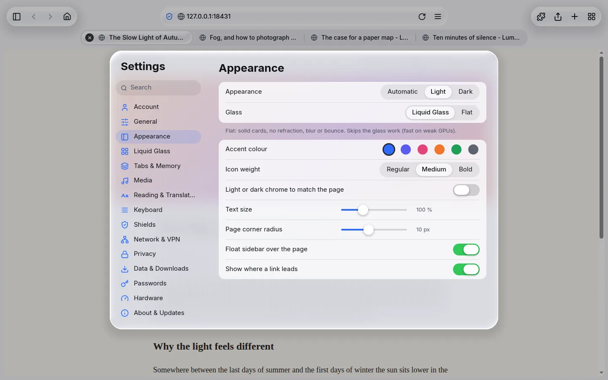
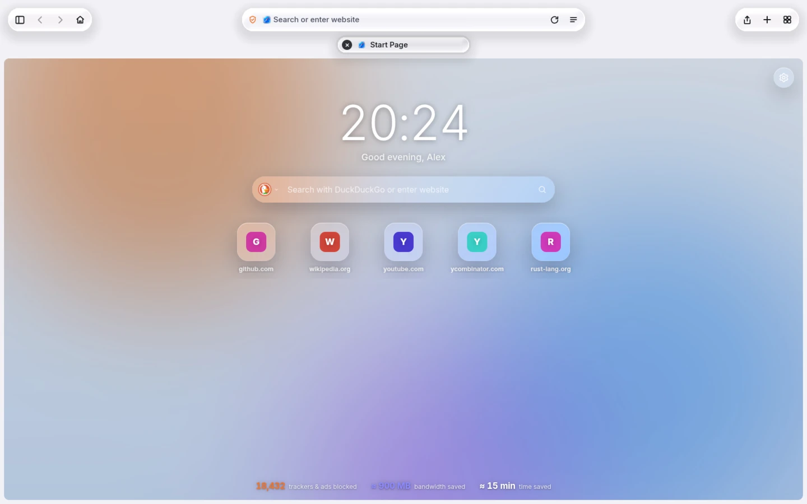
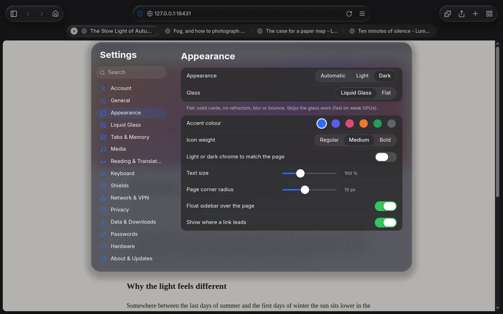
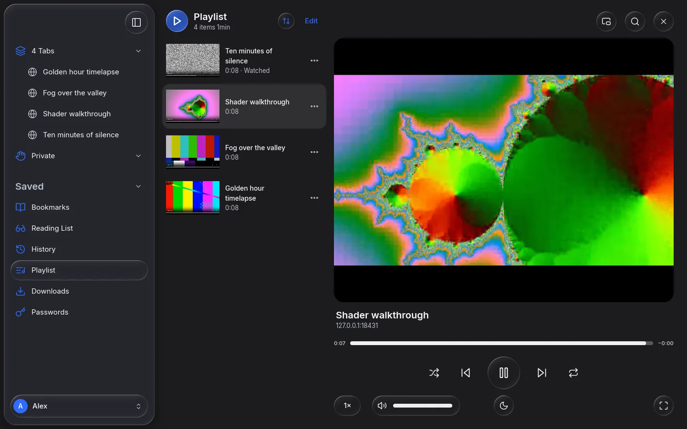

# Settings reference

Open Settings with **Ctrl+,** (or **Ctrl+S**), or from the page menu. The list on the left has one
page per topic. The search field at the top finds a setting by name (in English or German).

Every change is saved at once. A few changes need a restart; those say so.

**How to read the tables**

- **Setting** is the label you see in the app.
- **Default** is what a fresh install uses.
- **Config key** is the name in `config.toml`, written as `section.key`. You never need it unless you
  edit the file by hand. See [Configuration files](configuration.md).
- Sliders show their range in the description.

Pages, in the order of the list:
[Account](#account) -
[General](#general) -
[Appearance](#appearance) -
[Liquid Glass](#liquid-glass) -
[Tabs & Memory](#tabs--memory) -
[Media](#media) -
[Keyboard](#keyboard) -
[Shields](#shields) -
[Privacy](#privacy) -
[Data & Downloads](#data--downloads) -
[Passwords](#passwords) -
[Hardware](#hardware) -
[About & Updates](#about--updates)

---

## Account

Settings for the account you are using. Each account has its own tabs, history, bookmarks,
passwords, website data and settings. More in [Accounts and privacy](features/accounts-and-privacy.md).

| Setting | What it does | Default | Config key |
|---|---|---|---|
| **Name** (and **Save**) | The account's name, shown in the sidebar and in the greeting on the start page. | Your system user name | Stored in `accounts.toml` |
| **Photo** (**Choose Photo…**, **Remove Photo**) | A profile picture, picked with your desktop's file chooser. It is cropped to a square and copied into the account, so deleting the original is safe. Without a photo, coloured initials show. | None | `accounts.avatar_size_px` (256), `accounts.avatar_max_mb` (20) set the size and the largest file accepted |
| **Colour** | The colour of the initials circle. | First swatch | Stored in `accounts.toml` |
| **Password** (**Set Password** / **Change Password**) | One password for the whole account. It unlocks **Passwords** and the **Private** tabs. Axion cannot recover it if you forget it. | No password | Never stored |
| **Delete Account…** | Removes the account with its tabs, history, bookmarks, passwords, website data and settings. Click again to confirm. Not available for the only account. | - | - |

## General

| Setting | What it does | Default | Config key |
|---|---|---|---|
| **Homepage** | The page that opens in new windows and tabs. Leave the field empty for Axion's own start page. | Axion Home (`axion://home/`) | `general.homepage` |
| **Search engine** | Where searches typed in the address field and on the start page go. Choices: DuckDuckGo, Google, Brave, Startpage, Ecosia. | DuckDuckGo | `general.search_url` |
| **Language** | The language of Axion's own interface: System, English or Deutsch. Applies after you restart Axion. | System | `general.language` (`system`, `en`, `de`) |
| **Add Axion to the application menu** | Linux: adds Axion's desktop entry and icons for your user, which gives the window its icon in the taskbar and the application menu (on Wayland this is the only way). Applies after you restart Axion. | On | `general.desktop_integration` |
| **Welcome tour** (**Show Welcome Tour**) | Runs the first-start introduction again. | - | `general.onboarding_done` |
| **Show home button** | Puts a home button next to back and forward. It opens your homepage. | On | `layout.home_button` |

### Start page

What the start page shows. The same switches are in the gear on the page itself. See
[Start page](features/start-page.md).

| Setting | What it does | Default | Config key |
|---|---|---|---|
| **Clock** | Shows the large clock. | On | `home.show_clock` |
| **Greeting** | Shows "Good morning, name" under the clock. | On | `home.show_greeting` |
| **Search field** | Shows the search field. | On | `home.show_search` |
| **Top sites** | Shows tiles for your pinned and most visited sites. | On | `home.show_top_sites` |
| **Shields statistics** | Shows how many trackers and ads were blocked, and the bandwidth and time saved. | On | `home.show_stats` |

### Start page background

| Setting | What it does | Default | Config key |
|---|---|---|---|
| Background picker | Choose **None**, one of your backgrounds, or add one. Click the cross on a card to remove it. | None | `home.background` |
| **Dim** | Darkens the background so text stays readable. Shown once a background is selected (search lists it as "Dim background image"). 0 to 80 %. | 20 % | `home.background_dim` |
| **Blur** | Blurs the background. Shown once a background is selected ("Blur background image" in search). Off to 30 px. | Off | `home.background_blur` |
| **Live wallpapers (animated images and videos)** | Lets animated images (GIF, WebP) and videos (WebM, MP4) play, muted and looping. Off: they show a still frame. | On | `home.live_wallpapers` |
| **Play live wallpapers with Reduce Motion** | Keeps live wallpapers playing while **Reduce motion** is on. Off: they show a still frame then. | On | `home.live_wallpapers_ignore_reduce_motion` |
| **Add from file** (**Add**) | Type a path such as `~/Pictures/sea.jpg` and press **Add**. The file is copied into your account. MP4 needs H.264 support. | - | - |

### Developer

| Setting | What it does | Default | Config key |
|---|---|---|---|
| **Developer tools** | Allows Chromium's developer tools (F12, Ctrl+Shift+I) and view source (Ctrl+U). Off: none of these shortcuts do anything. See [Developer tools](features/developer-tools.md). | On | `devtools.enabled` |

## Appearance

How Axion looks. See [Appearance and Liquid Glass](features/appearance-and-glass.md).

| Setting | What it does | Default | Config key |
|---|---|---|---|
| **Appearance** | **Automatic** follows your desktop's light or dark preference, or force **Light** or **Dark**. | Automatic | `appearance.theme` (`auto`, `light`, `dark`) |
| **Glass** | **Liquid Glass** is the full glass look. **Flat** uses solid cards without refraction, blur or bounce. It is much lighter on weak graphics hardware. | Liquid Glass | `glass.style` (`liquid`, `flat`) |
| **Accent colour** | The colour of selections, focus rings and primary buttons. Six swatches. | Blue | `appearance.accent` (a colour such as `"#2E6BFF"`) |
| **Icon weight** | The line thickness of icons: **Regular**, **Medium** or **Bold**. | Medium | `appearance.icon_stroke_light`, `appearance.icon_stroke_dark` |
| **Favicon contrast** (config only) | What happens to website icons that would be hard to see on the current bar (for example a black icon on the dark bar): `invert` flips single-colour icons, `backing` puts them on a light or dark tile, `off` leaves them as they are. | `invert` | `appearance.favicon_contrast` |
| **Light or dark chrome to match the page** | Switches the toolbar between light and dark to match the page's top edge. Off: it follows **Appearance** only. | Off | `appearance.adapt_to_page` |
| **Text size** | Scales all of Axion's own text. 85 to 130 %. Web pages have their own zoom (Ctrl++, Ctrl+-). | 100 % | `appearance.text_scale` |
| **Page corner radius** | How round the corners of the page card are. 0 to 24 px. | 10 px | `layout.page_corner_radius` |
| **Float sidebar over the page** | Always floats the sidebar over the page as a glass card instead of docking it beside the page. | Off | `layout.float_sidebar` |

## Liquid Glass

Fine-tune the glass material. These settings only matter with **Glass** set to **Liquid Glass**. See
[Appearance and Liquid Glass](features/appearance-and-glass.md).

| Setting | What it does | Default | Config key |
|---|---|---|---|
| **Reduce transparency** | Replaces glass with opaque surfaces. | Off | `glass.reduce_transparency` |
| **Reduce motion** | Replaces springs and stretching with short fades. | Off | `glass.reduce_motion` |
| **Refraction** | How strongly the glass bends what is behind it. 0 to 100 %. | 55 % | `glass.light.refraction`, `glass.dark.refraction` |
| **Blur** | How much the backdrop is blurred, as a share of the normal amount for each glass thickness. 0 to 200 %. | 100 % | `glass.light.blur`, `glass.dark.blur` (`thin`, `regular`, `thick`) |
| **Colour dispersion** | Colour fringes along the glass rim. 0 to 40 %. | 12 % (10 % in dark mode) | `glass.light.dispersion`, `glass.dark.dispersion` |
| **Squash when moving** | How far glass stretches along the direction you drag it. 0 to 20 %. | 8 % | `glass.squash` |
| **Drag stretch (maximum)** | The most a glass control (a held button, a switch or slider knob) stretches when you pull it far from where it rests; the icon or label stays in place and stretches the same way. 0 to 20 %. Off with Reduce motion and in flat mode. | 8 % | `glass.drag_stretch_max` |
| **Drag resistance** | Distance at which a pulled control has reached about two thirds of its maximum stretch: it responds at once, but pulling further gets progressively harder. 5 to 200 px. | 40 px | `glass.drag_resistance` |
| **Merge distance** | How close two glass shapes must be before they flow together. 0 to 40 px. | 20 px | `glass.merge_distance` |

## Tabs & Memory

How tabs look and how Axion saves memory. See [Tabs and memory](features/tabs-and-memory.md).

| Setting | What it does | Default | Config key |
|---|---|---|---|
| Tab bar picture (**Separate** / **Compact**) | **Separate** puts tabs in their own row below the address bar. **Compact** uses one row where all tabs are the same width and the current tab holds the address; the address field widens while you type (`layout.compact_address_width`). | Separate | `layout.tab_bar` (`separate`, `compact`) |
| **Colour in tab bar** | Tints the window around the page with a colour taken from the page, like Safari. | Off | `appearance.tint_from_page` |
| **Page colour** (**Extreme** / **Dominant**) | Shown when **Colour in tab bar** is on. **Extreme** takes the darkest or lightest prominent colour. **Dominant** takes the main colour, evened out. Turning the colour on switches from neutral to **Extreme**. | Neutral (page colour off) | `appearance.tint_mode` (`neutral`, `extreme`, `dominant`) |
| **Open new tabs in background** | Tabs opened from links do not take over the screen. | On | `tabs.open_links_in_background` |
| **Close tabs** | Closes tabs you have not looked at for a while: **Manually** (never), **After a Day**, **After a Week**, **After a Month**. Pinned tabs and tabs playing media stay. | Manually | `tabs.close_after_days` (0, 1, 7, 30) |
| **Bookmarks bar** | When the bookmarks bar shows: **Always**, **On Home Page**, **Never**. | Always | `layout.bookmarks_bar` (`always`, `home`, `never`) |

### Memory

| Setting | What it does | Default | Config key |
|---|---|---|---|
| **Freeze background tabs after** | Pauses scripts and timers of a tab after this long in the background. Never to 60 min. | 10 min | `tabs.freeze_after_minutes` |
| **Unload background tabs after** | Unloads a background tab after this long, keeping only its address and a picture. It reloads when you open it. Never to 8 h. | 2 h | `tabs.discard_after_minutes` |
| **Unload tabs when memory runs over the budget** | When Axion uses more memory than the budget, unloads background tabs, the longest unused first. | On | `tabs.limit_memory` |
| **Memory budget** | The budget for the whole browser. **Automatic** is 40 % of your computer's memory. Otherwise pick an amount in steps of 256 MB, up to 6 GB. | Automatic | `tabs.memory_budget_mb` (0 = automatic) |
| **Keep tabs playing audio awake** | Tabs that play sound or video are never frozen or unloaded. | On | `tabs.keep_media_awake` |
| **Reopen last session's tabs at start** | Brings back your tabs when Axion starts. They load when you first look at them. | On | `tabs.restore_session` |

The last line of the page shows how much memory Axion uses right now and the current budget.

## Media

Video, audio and the Playlist. See [Media and Playlist](features/media-and-playlist.md).

| Setting | What it does | Default | Config key |
|---|---|---|---|
| **Axion's player in fullscreen** | When a video goes fullscreen, Axion's own glass controls take over. Inline, pages keep their own controls. | On | `media.fullscreen_player` |
| **Hide controls while playing after** | Hides the controls after this long without mouse movement. 1 to 10 s. | 2.5 s | `media.hide_controls_after_seconds` |

### Playlist

| Setting | What it does | Default | Config key |
|---|---|---|---|
| **Playlist button in the address field** | Shows the Add to Playlist button on pages with a video. | On | `playlist.quick_action` |
| **Download videos when adding them to the Playlist** | Downloads a video for offline use as soon as you add it, when it is a plain video file. | Off | `playlist.auto_download` |
| **Delete downloaded files when removing videos** | Removing a video from the Playlist also deletes its downloaded file. | On | `playlist.delete_files_on_remove` |
| **Playlist sort** | **Newest First**, **Oldest First** or **Custom Order** (the order you arranged in Edit mode). | Newest First | `playlist.sort` (`newest`, `oldest`, `manual`) |
| **Playlist downloads** (**Change…**, **Default**) | The folder for downloaded videos. Changing it affects new downloads only. | Axion's data folder of the account | `playlist.directory` |

### Sites that keep their own player

A list of sites whose own video player stays in place, also in fullscreen. Type a site name such as
`example.com` under **Add a site** and press **Add**. Subdomains count too. Use the cross to remove
a site. Changes apply to pages loaded next.

| Setting | What it does | Default | Config key |
|---|---|---|---|
| Trusted sites list | Sites that keep their own player. | YouTube, Twitch, Vimeo, Dailymotion, Netflix, Disney+, Prime Video, Crunchyroll, Spotify, SoundCloud | `media.trusted_player_sites` |

### Playback

| Setting | What it does | Default | Config key |
|---|---|---|---|
| **Hardware video decoding (after restart)** | Decodes video on the graphics card (VA-API). The same switch is on the Hardware page. | On | `media.hardware_decoding` |
| **Desktop media controls and media keys (after restart)** | Shows what is playing in your desktop's media widgets and reacts to your keyboard's media keys (MPRIS). | On | `media.desktop_integration` |

## Keyboard

A searchable list of all shortcuts, grouped by area. To change one, edit `keymap.toml`; edits
apply immediately. See [Keyboard shortcuts](keyboard-shortcuts.md).

## Shields

Blocking of ads, trackers, popups and redirects. See [Shields](features/shields.md).

| Setting | What it does | Default | Config key |
|---|---|---|---|
| **Shields on sites you haven't set** | The level for every site that has no level of its own: **Off**, **Standard** or **Aggressive**. | Standard | `shields.default_level` (`off`, `standard`, `aggressive`) |
| **Hide empty ad spaces** | Hides the gaps and placeholders that blocked ads leave behind. | On | `shields.hide_ad_elements` |
| **Block popups opened without a click** | Blocks tabs and windows a page opens by itself. | On | `shields.block_popups` |
| **Block redirects to ad and tracker sites** | Blocks pages that send you elsewhere without a click, to sites on the block lists. | On | `shields.block_redirects` |
| **Remove tracking parameters from links** | Cuts click-tracking parts such as `fbclid` and `gclid` out of addresses. | On | `shields.strip_tracking_parameters` |
| **Block third-party cookies** | Stops sites from setting cookies for other sites. | On | `shields.block_third_party_cookies` |
| **Filter lists** (**Update Now**) | The block lists in use and how often they refresh. **Update Now** refreshes them at once. | 5 lists, every 96 hours | `shields.lists`, `shields.update_interval_hours` |

## Privacy

| Setting | What it does | Default | Config key |
|---|---|---|---|
| **Lock private tabs with the account password** | Private tabs ask for the account password before they open. Needs an account password; the page offers to create one. | On | `privacy.lock_private_tabs` |
| **Browsing history** (**Clear History…**) | Deletes your whole browsing history. Click again to confirm. For a time range, use **Clear Browsing Data…** | - | - |

### Site Permissions

What happens when a site asks for your microphone, camera, screen and the like and you have not
decided for that site yet. **Ask** shows the permission prompt under the address field; **Block**
refuses without asking. A decision you made for a site wins over these. See
[Site permissions](features/site-permissions.md).

| Setting | What it does | Default | Config key |
|---|---|---|---|
| **Microphone** | Calls and voice chat (`getUserMedia` with audio). | Ask | `permissions.microphone` (`ask`, `block`) |
| **Camera** | Video calls (`getUserMedia` with video). | Ask | `permissions.camera` |
| **Screen sharing** | Sharing a screen or window (Discord, Meet). Always asks: allowing is never remembered. | Ask | `permissions.screen_sharing` |
| **Notifications** | Desktop notifications from the site. | Ask | `permissions.notifications` |
| **Location** | Your position. | Ask | `permissions.location` |
| **Clipboard** | Reading what you copied (writing to the clipboard needs no permission). | Ask | `permissions.clipboard` |
| **Other permissions** | MIDI devices, the local network, window placement on all displays, installed fonts, idle detection, pointer and keyboard lock, motion sensors, several downloads at once. | Ask | `permissions.other` |

### Remembered for Sites

| Setting | What it does | Default | Config key |
|---|---|---|---|
| Decision list (**Reset All**) | Every site decision you made with **Always Allow** or **Don't Allow**: the site, what, and **Allowed** or **Blocked**. Remove one with its cross, or all with **Reset All** (click again to confirm). The site asks again next time. | - | - |

Decisions in private tabs are kept in memory only and are forgotten when Axion quits; they are not
listed here.

## Data & Downloads

### Downloads

| Setting | What it does | Default | Config key |
|---|---|---|---|
| **Download location** (**Change…**) | The folder for downloads. | Your desktop's Downloads folder | `downloads.directory` |
| **Ask where to save each file** | Shows a file chooser for each download. Off: saves straight into the download location. | On | `downloads.ask_where_to_save` |
| **Open “safe” files after downloading** | Opens pictures, movies, sounds, PDF and text documents when they finish. | Off | `downloads.open_safe_files` |
| **Remove download list items** | When finished downloads leave the list: **Manually**, **After One Day**, **When Axion Quits**. | Manually | `downloads.remove_list_items` (`manually`, `after_one_day`, `on_quit`) |

### Import from another browser

Brings bookmarks and history from the other browsers on this computer into the current account.
Axion only reads the other browser's files (it copies its databases to a temporary file first, so a
running browser is no problem) and never changes them. Passwords and cookies are not imported:
other browsers encrypt them with the desktop keyring. Export your passwords there as a CSV file and
import it under [Settings > Passwords](#import-and-export).

| Setting | What it does | Default | Config key |
|---|---|---|---|
| Browser list | The browsers and profiles found (Chrome, Chromium, Brave, Edge, Vivaldi, Opera; Firefox, LibreWolf, Zen, Waterfox, Floorp; also their Flatpak and Snap versions), each with the number of bookmarks and history entries. Tick the ones to import; the most recently used one is ticked at first. | - | - |
| **Bookmarks**, **History** | What to import from the ticked browsers. | Both | - |
| **Import** | Starts the import in the background. The result is shown under the list (for example “Imported 312 bookmarks and 8,450 history entries; 40 already existed”) and as a notification. The sidebar lists, the bookmarks bar and the start page's top sites update by themselves. | - | - |
| **Import from File…** | Imports bookmarks from a file: the HTML export every browser can make (**Export bookmarks**), a Chromium `Bookmarks` file or a Firefox JSON backup. | - | - |
| **Open Passwords** | Goes to the Passwords page. | - | - |
| Limit for history | At most this many history entries are imported per browser profile, the most recently visited first. | 20000 | `import.max_history_items` |
| Limit for bookmarks | At most this many bookmarks per profile or file. | 50000 | `import.max_bookmarks` |
| Size limit for databases | Larger browser databases are skipped (MB). They are copied to a temporary file, so this much space is needed. | 512 | `import.max_database_mb` |
| Size limit for files | Larger bookmark files are refused (MB). | 64 | `import.max_file_mb` |

Entries you already have (same address) are kept as they are and counted as “already existed”, so
importing twice is safe. Bookmarks from a browser's bookmarks bar land on Axion's bookmarks bar; those
in other folders appear in the sidebar's Bookmarks list with their old folder (for example
“Dev / Rust”). Imports always go into the account that is open. The limits have no controls in
Settings; change them in `config.toml`.

### Clear browsing data

| Setting | What it does | Default | Config key |
|---|---|---|---|
| **Time range** | How far back to clear: **Last Hour**, **Today**, **Last 7 Days**, **All Time**. A range clears cookies only for sites you visited in it. The cache is always cleared completely. | All Time | `data.clear_range` (`last_hour`, `today`, `last_week`, `all_time`) |
| **Browsing history** | Include history. | On | `data.clear_history` |
| **Cookies and other site data** | Include cookies and site data. | On | `data.clear_cookies` |
| **Cached images and files** | Include the cache. Its size is shown. | On | `data.clear_cache` |
| **Downloads list** | Include the downloads list (not the files). | On | `data.clear_downloads` |
| **Clear Browsing Data…** | Clears what is ticked. Click again to confirm. | - | - |

The ticks are remembered for the next time.

### Cookies and website data

| Setting | What it does | Default | Config key |
|---|---|---|---|
| **Clear cookies and site data when Axion quits** | Deletes all cookies and site data on every quit. You are signed out of websites each time. | Off | `data.clear_cookies_on_quit` |
| Site list (**Remove All**) | Lists the sites that store cookies, with the number of cookies. Remove one with its cross or all with **Remove All**. | - | - |

## Passwords

The password manager. See [Passwords](features/passwords.md).

| Setting | What it does | Default | Config key |
|---|---|---|---|
| **Open Passwords** | Opens your saved passwords, cards and addresses. | - | - |
| **Offer to save passwords** | After you sign in to a site, asks whether to save the password. | On | `passwords.offer_to_save` |
| **Offer to fill saved passwords** | Offers saved logins on sign-in forms. | On | `passwords.autofill` |
| **Clear clipboard after copying** | Empties the clipboard this long after you copy a password or card number. Never to 5 min. | 60 s | `passwords.clear_clipboard_seconds` |

### Import and export

Type the path of a file in **File** and, for exports and restores, the account **Password**. Then
use a button.

| Button | What it does |
|---|---|
| **Import CSV** | Imports logins from a CSV file exported by Chrome, Firefox or Bitwarden. |
| **Export Encrypted Copy** | Writes an encrypted copy of your vault. It can be restored on any device. |
| **Restore Axion Export** | Reads such an export back into your vault. |

## Hardware

Graphics card and acceleration. Changes apply after a restart; a **Restart Axion to Apply** button
appears when needed. See [Hardware acceleration](features/hardware-acceleration.md).

| Setting | What it does | Default | Config key |
|---|---|---|---|
| **Use hardware acceleration** | Master switch. Off: Chromium draws pages, video and canvas in software. Axion's own interface always needs the graphics card. | On | `hardware.enabled` |
| **Hardware video decoding** | Decodes video on the graphics card (VA-API). Also on the Media page. | On | `media.hardware_decoding` |
| **Smooth WebGL, canvas and GPU rasterization** | Lets Chromium draw web graphics on the graphics card. Off adds software drawing. | On | `hardware.gpu_rasterization` |
| **Page frames** | How finished page pictures reach Axion: **Automatic**, **Shared GPU memory** or **Software**. | Automatic | `hardware.page_frames` (`auto`, `gpu`, `software`) |
| **Graphics card** | Which card to use: **Automatic**, **Integrated** (saves power) or **Dedicated** (fastest). | Automatic | `hardware.gpu` (`auto`, `low`, `high`) |
| **Copy Diagnostics** | Copies a plain-text summary (card, driver, mode, Chromium version) to the clipboard for bug reports. | - | - |

The page also lists the graphics cards found (**In use**, **Also available**) and a **GPU status**
block showing what is really active.

## About & Updates

Version information and updates. See [Updates](features/updates.md).

| Setting | What it does | Default | Config key |
|---|---|---|---|
| **Check for Updates** | Asks the update source for the newest version now. | - | - |
| **Check for updates automatically** | Looks for a new version a few seconds after Axion starts, at most once a day. | On | `updates.auto_check_on_start` |
| **Include pre-releases** | Also offers alpha, beta and release-candidate versions. | Off | `updates.channel` (`stable`, `prerelease`) |
| **Repository** (**Save**) | Where releases are published, written `owner/name`. The field is empty and shows the default as a placeholder; typing your own repository overrides it, clearing the field returns to the default (nothing is stored for the default). | `xyzhenrik/Axion` (empty field) | `updates.repository` |

When an update is available the page also shows the release notes and the buttons **Update** (or
**Update from Git**, or **Open Release Page**), **Skip This Version** and **Remind Me Later**.

---

Settings you cannot find here (timings, sizes, limits) live only in `config.toml`. The file format
and the most useful extra keys are in [Configuration files](configuration.md).
